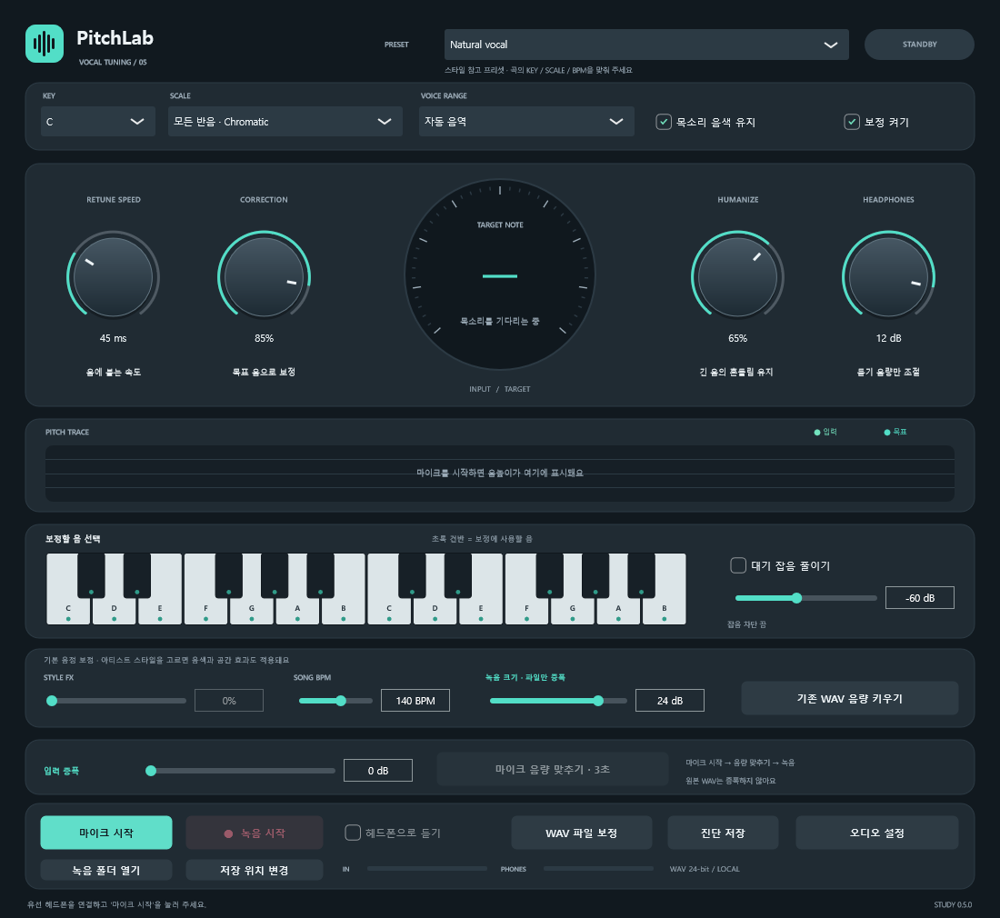

# PitchLab — Real-Time Vocal Pitch Processing

[English](README.md) · [Korean](README.ko.md) · [Japanese](README.ja.md)

**C++ · JUCE · WASAPI · DSP** · C++システム開発事例

[開発事例を見る](https://ysl-ryudo.github.io/ja/work/pitchlab/) · [Portfolio](https://ysl-ryudo.github.io/ja/)

マイクの音程補正、録音、オフラインWAV処理に対応するWindows C++/JUCEアプリです。

## 取り組んだ課題

マイク処理はリアルタイム入力とピッチ分析・補正・録音を組み合わせます。コールバックと処理ワーカー間に容量を制限した受け渡しを設けました。

## 担当した実装と設計

DSPワーカーと容量制限付きFIFOで処理・録音をコールバックから分離し、WASAPI入力形式を調査しました。入力校正、診断、WAV回帰検証も追加しました。

### 実装概要 · 概念フロー

## 担当した内容

- 専用DSPワーカーと容量制限付きFIFOで、音程解析・処理・録音をデバイスコールバックから分離しました。
- WASAPIの入力形式処理を調査し、入力レベル調整、出力保護、診断機能を実装しました。
- DSP、ストリーミング、入力調整、ノイズゲート、WAV出力の回帰検査を追加しました。

## 貢献の根拠

- [Audio callback / 오디오 콜백 / 音声コールバック](https://github.com/YSL-RyuDo/pitchlab/blob/5bcbac396627611e5ec12c8384fdc0733d636f8c/Source/AudioEngine.h)
- [Development history / 개발 이력 / 開発履歴](https://github.com/YSL-RyuDo/pitchlab/commits/main/?author=YSL-RyuDo)

コミットは記載した変更の根拠であり、貢献率の点数ではありません。外部素材・チームメンバーの貢献は区別します。

## 実行・コードの確認

C++/JUCEビルドは[CMakeLists.txt](CMakeLists.txt)、デバイス・録音設定は既存の詳細資料を参照してください。

## 開発・検証範囲

ゲームサーバーベンチマークではなく補助的なC++技術プロジェクトです。合成信号・ファイル検査は全マイク・ヘッドホンでの品質を証明しません。アーティスト名のプリセットは公式設定ではなく近似で、個人の音声録音は含めません。

## 詳細資料

- [既存の詳細開発・利用・検証資料（韓国語）](docs/DEVELOPMENT_REFERENCE.ko.md)
- [TEST-RESULTS.txt](TEST-RESULTS.txt)
- [LIVE-VOICE-TEST-RESULTS.txt](LIVE-VOICE-TEST-RESULTS.txt)
- [ThirdParty/JUCE-LICENSE.md](ThirdParty/JUCE-LICENSE.md)

## 実装の確認方法

AudioEngine.hと合成・ファイル検証記録から構造と検証方法を確認できます。あらゆる実機マイクで同じ品質を保証する結果ではありません。
